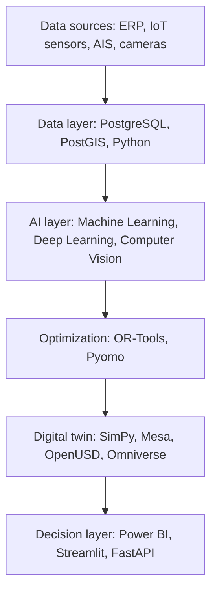

# AI-Driven Operations Platform

**Machine Learning, Computer Vision, Optimization and Digital Twins for Manufacturing, Healthcare and Global Logistics**

A reusable AI-driven operations architecture applied to three digital twins. All applications share the same data layer, AI models, optimization and simulation engines, showing how a single platform can support very different industries.

> **Status:** In active development. Currently building the Smart Factory data layer.

## Projects

| Project | Industries | Status |
|---|---|---|
| [Smart Factory & Human Performance Digital Twin](apps/smart_factory) | Manufacturing, Robotics, Logistics, Human Factors | In progress |
| [Neuro-Healthcare Supply Chain Digital Twin](apps/neuro_healthcare) | Neuroscience, Healthcare, Manufacturing, Supply Chain | Planned |
| [Smart Port & Maritime Logistics Digital Twin](apps/smart_port) | Maritime, Logistics, Climate, Finance | Planned |

## Architecture



## Tech Stack

| Layer | Tools |
|---|---|
| Data | Python, SQL, PostgreSQL, PostGIS, pandas, NumPy, GeoPandas |
| Machine Learning | scikit-learn, XGBoost, LightGBM |
| Deep Learning | PyTorch, Darts, MNE-Python, Braindecode |
| Computer Vision | OpenCV, YOLO, anomalib |
| Optimization | OR-Tools, Pyomo |
| Simulation & Robotics | SimPy, Mesa, PyBullet, NVIDIA Isaac Sim |
| 3D Digital Twin | OpenUSD, Blender, NVIDIA Omniverse |
| MLOps & Delivery | MLflow, FastAPI, Streamlit, Power BI, Git, AWS |

## Repository Structure

```
ai-driven-operations/
├── core/              # Shared, reusable code (database, simulation, forecasting, CV, optimization)
├── apps/
│   ├── smart_factory/
│   ├── neuro_healthcare/
│   └── smart_port/
├── sql/               # Database schemas, one per application
├── data/              # Local data, generated or downloaded (not tracked)
├── dashboards/        # Power BI reports
└── docs/              # Architecture notes, design decisions and ethics
```

## Data & Ethics

This project uses only public datasets and synthetic data. The human-factors components are framed as ergonomic design research, not worker surveillance. A detailed note on privacy and responsible use will be added in `docs/`.

## Author

**Masson Lopez** | B.S. Supply Chain and Logistics Technology, University of Houston (2026) | A.A.S. Artificial Intelligence, Houston City College